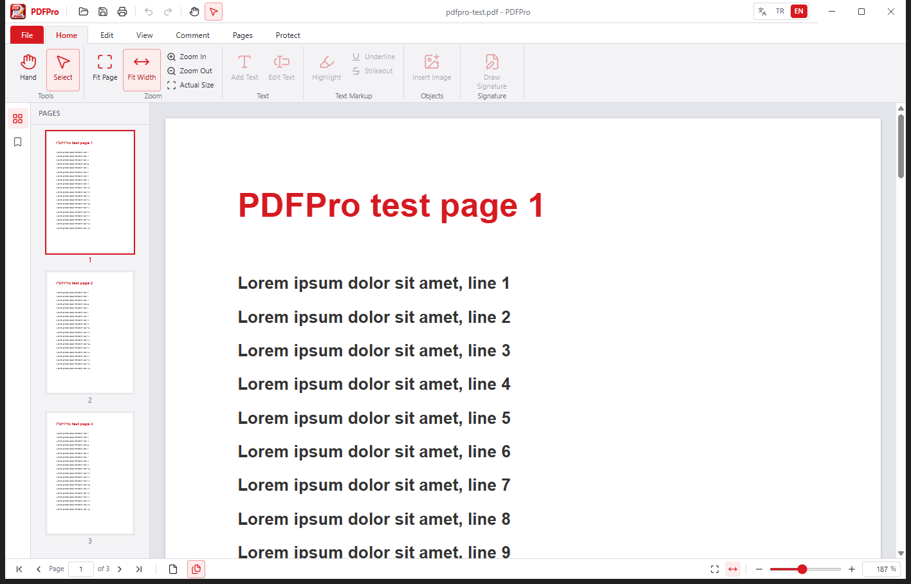

# PDFPro

Çevrimdışı çalışan masaüstü PDF görüntüleyici ve düzenleyici. Electron, React, TypeScript ve TailwindCSS ile yazılmıştır.



## Kurulum

Windows kurulumu GitHub sürümünden indirilir: [PDFPro-Setup-0.1.0.exe](https://github.com/serkanyavuzmercan-gif/PDFPro/releases/download/v0.1.0/PDFPro-Setup-0.1.0.exe)

Kurulum sihirbazı kurulum klasörünü seçmenize izin verir ve masaüstü kısayolu oluşturur. `.pdf` dosyaları PDFPro ile açılır.

## Bu sürümde

- Tek örnek: uygulama açıkken ikinci kez başlatılırsa mevcut pencere öne gelir.
- Foxit tarzı şerit menü: Dosya, Giriş, Düzenle, Görünüm, Yorum, Sayfalar, Koruma.
- Türkçe ve İngilizce arayüz (başlıktaki TR / EN).
- Sayfa küçük resimleri, yer imleri, sürekli veya tek sayfa görünümü, sayfaya gitme.
- Yakınlaştırma: kaydırıcı, yüzde, sayfaya sığdır, genişliğe sığdır, Ctrl + fare tekerleği.
- El aracı ile sürükleyerek kaydırma.

Metin, işaretleme, resim, sayfa düzenleme ve imza araçları şeritte yer alır; sonraki sürümlerde etkinleşir.

## Geliştirme

```bash
npm install
npm run dev
```

Windows kurulumu:

```bash
npm run dist:win
```

Çıktı `release/` altındadır. macOS için `npm run dist:mac` bir Mac üzerinde çalıştırılır.
